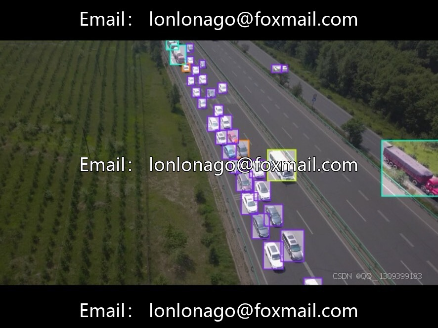
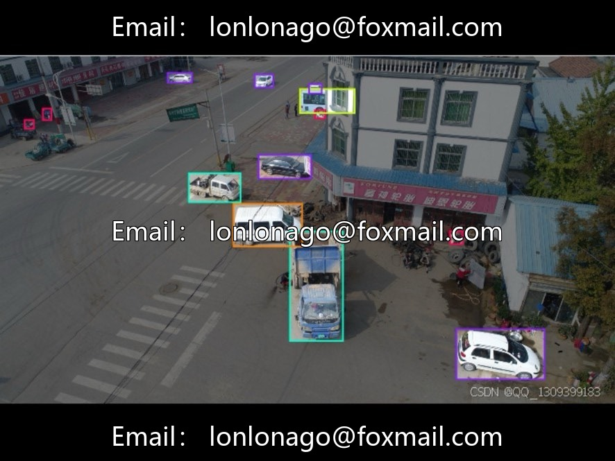
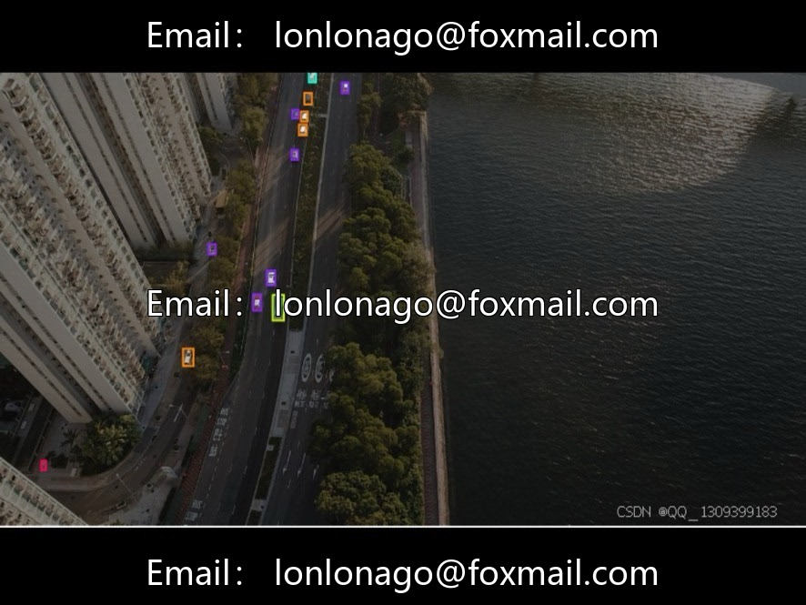
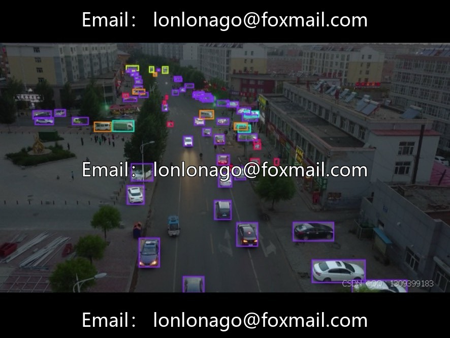
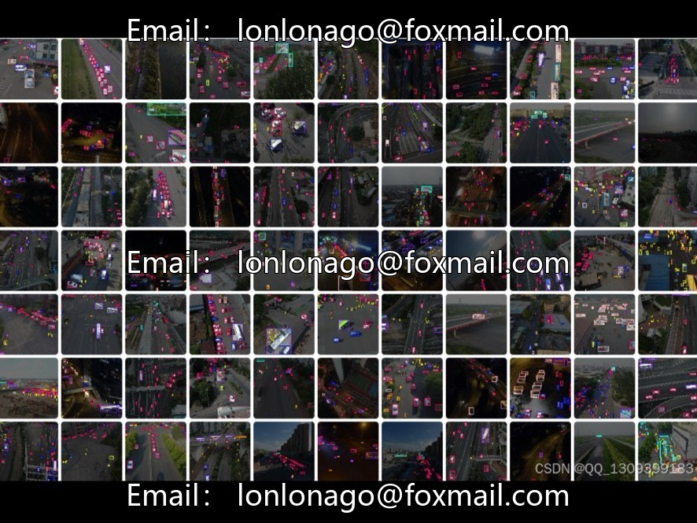

# Drone aerial photography traffic scene segmentation dataset | Issue 10066

## Body

Drone aerial photography traffic scene segmentation dataset | Issue 10066

Contains 515 high-resolution aerial images, covering 17 categories of traffic participants and facilities such as bicycles, motorcycles, buses, trucks, pickup trucks, tractors, etc. Suitable for semantic segmentation tasks, data aligned with actual surveillance equipment output, rich in details, suitable for algorithm training and validation in intelligent transportation systems, autonomous driving perception modules.

The dataset consists of 42 sub-datasets, supporting flexible partitioning of training/test sets. It is adaptable to various experimental needs such as cross-validation and small sample learning, focusing on complex interactions at intersections, including challenges like multi-object occlusion and scale variations.

The image resolution is close to the actual surveillance equipment output, with pixel-level semantic segmentation labels. The data format is pending confirmation (it is recommended to refer to the source file).

Virtual materials, once sold, are non-refundable.
Interested friends, click "I want" to proceed.

## Images

## Payment

Here is a pay link on Stripe ( https://buy.stripe.com/3cs8yP7sY87d0vu9AB ). Please contact me lonlonago@foxmail.com after funding $89, and I will send you a complete data files , thank you!

